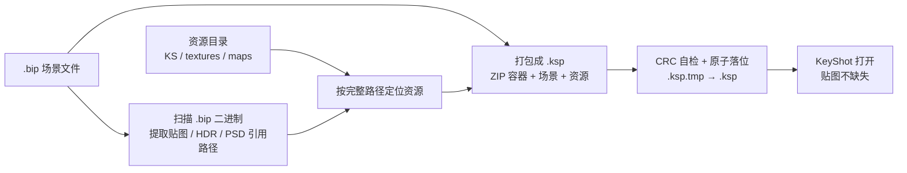

# 炮王 ks 渲染一键打包器 · KeyShot `.bip` → `.ksp` 打包工具

**一句话说明**：把 KeyShot 场景文件 `.bip` 和它引用的贴图、HDR、PSD 自动收齐，一键打成一个 `.ksp`（KeyShot Package）文件；Windows 单文件绿色程序，双击即用，不用装 KeyShot 插件，也不用装 Python。

**English**: A portable Windows tool that converts KeyShot `.bip` scene files into `.ksp` (KeyShot Package) files, automatically collecting referenced textures, HDRIs and PSDs. No installation, no Python, no KeyShot plugin required.

| 项目 | 内容 |
| --- | --- |
| 版本 | **v2.4**（程序内发布日期 2026-10-17） |
| 作者 | 杨平 · 1187574340yangping@gmail.com |
| 平台 | Windows，PyInstaller 单文件 exe（Python 3.13） |
| 输入 | `.bip` 文件，或含多个 `.bip` 的目录 |
| 输出 | `.ksp`（KeyShot Package，本质是 ZIP） |
| 安装 | 无需安装，下载后双击运行 |
| 源码 | **本仓库只发布可执行文件，不含源码** |

> 程序自述：「本程序为自用工具，欢迎分享，请保留作者信息。」以下功能与版本信息全部取自 exe 内部程序自述（PyInstaller 解包后提取的字符串常量），不是推测。

---

## ⬇️ 下载（Windows，免安装）

### [👉 直接下载 炮王ks渲染一键打包器.exe（10.1 MB）](https://github.com/1187574340yangping-hash/paowang-ks-render-packer/raw/refs/heads/main/%E7%82%AE%E7%8E%8Bks%E6%B8%B2%E6%9F%93%E4%B8%80%E9%94%AE%E6%89%93%E5%8C%85%E5%99%A8.exe)

下载后**直接双击**即可打开图形界面，不需要解压、不需要安装、不需要管理员权限。也可以在仓库文件列表里点 [`炮王ks渲染一键打包器.exe`](./炮王ks渲染一键打包器.exe)，再点 **Download raw file**。

校验文件完整性（PowerShell）：

```powershell
(Get-FileHash .\炮王ks渲染一键打包器.exe -Algorithm SHA256).Hash
# 应为 3E9A44024C72F309F9DA7E756E1F64AE06BFCD099190CFC5675FB13C622E4631
```

---

## 这个工具解决什么问题

如果你搜的是下面这些情况，那就是这个工具要处理的：

- **「KeyShot 打开 bip 贴图全丢了 / 材质变白」**——`.bip` 只记录贴图路径，文件发到别的电脑就找不到图。
- **「怎么把 bip 连同 KS 文件夹一起打包」**——程序会扫描 `.bip` 二进制里引用的贴图 / HDR / PSD 路径并自动找出来一起打进包。
- **「bip 转 ksp / 怎么生成 KeyShot Package」**——输出的就是官方格式的 `.ksp` 包。
- **「多个 bip 批量打包」**——支持选整个目录，每个 `.bip` 单独出一个 `.ksp`，也可以合并成一个。
- **「打包后中文贴图名乱码」**——包内非 ASCII 文件名带 UTF-8 标记（0x800）。
- **「打包到一半失败留下坏文件」**——先写临时文件、CRC 自检通过后才落位，失败整体回滚。
- **「换电脑 / 发给同事 / 交付客户渲染工程」**——一个 `.ksp` 带走场景和素材，不用手工整理贴图目录。

## 检索关键词 / Keywords

`KeyShot` · `bip` · `ksp` · `KeyShot Package` · `bip 转 ksp` · `bip2ksp` · `bip to ksp` · `.bip 打包` · `贴图打包` · `贴图收集` · `资源收集` · `HDR` · `PSD` · `KS 文件夹` · `场景迁移` · `渲染工程交付` · `材质丢贴图` · `中文文件名乱码` · `一键打包` · `绿色软件` · `Windows exe` · `KeyShot package maker` · `KeyShot texture collector` · `bip scene packer`

---

## 三步上手

双击 exe，界面按顺序填三处：

| 步骤 | 填什么 | 说明 |
| --- | --- | --- |
| ① | `.bip` 文件或所在目录 | 必填；选目录可批量处理 |
| ② | 贴图 / 资源目录 | 一般就是 `KS` 文件夹；**留空会自动找**，在 bip 同级、上级及其子目录中查找，名字像 `KS` / `贴图` / `textures` / `maps` / `tex` 的目录优先 |
| ③ | `.ksp` 输出目录 | 必填，默认目录名 `KSP输出` |

第一次用建议先勾「**仅预览会打包哪些文件**」，确认清单没问题再正式打包，不会写任何文件。

可选设置：每个 `.bip` 单独一个 `.ksp`（推荐，默认）/ 全部合并成一个 / 覆盖已存在的 `.ksp` / 不压缩（更快、包更大）/ 不自动收集贴图（只打包 bip）/ 取消。取消时未完成的临时包会丢弃，不留坏文件。

## 常见问题

**Q：需要装 KeyShot 吗？需要装 Python 吗？**
A：都不需要，exe 自带运行环境。KeyShot 只是用来打开产出的 `.ksp`。

**Q：支持哪个 KeyShot 版本（9 / 11 / 2023 / 2024…）？**
A：**exe 内没有声明支持的 KeyShot 版本**，这一项不做推测，实际兼容性请以运行验证为准。程序变更记录里的 `create_version 20 -> 30` **不是 KeyShot 软件版本**，而是 `.ksp` 容器（ZIP）头字段的版本号，官方产出写的是 `3.0`；v2.4 的主要改动就是把这个容器格式对齐官方。

**Q：命令行能用吗？**
A：程序自述里有一套源码版 `bip_to_ksp.py` 的 CLI 参数（见下表），但**本仓库不含该脚本，exe 是 GUI 版，不能直接拿 exe 加这些参数调用**。

**Q：杀毒软件报毒？**
A：PyInstaller 打包的程序有时会被 Windows Defender 或第三方杀软误报，运行前请自行确认文件来源可信，并用上面的 SHA-256 校验。

**Q：有源码吗？**
A：没有，这个仓库只发布成品 exe。

---

## 命令行参数（源码版 `bip_to_ksp.py`，供参考）

| 参数 | 说明 |
| --- | --- |
| `-i, --input` | 输入的 `.bip` 文件或目录（必填） |
| `-o, --output` | KSP 输出目录 |
| `-a, --assets` | 资源搜索根目录，可指定多个（如贴图所在的 `KS` 文件夹） |
| `--mode each\|group` | `each` 每个 bip 一个 ksp（默认）；`group` 合并成一个 |
| `--include-all` | 不扫描，直接把资源目录下所有贴图塞进去（兜底方案） |
| `--include-source-dir` | 额外打包 bip 同级目录的资源文件 |
| `--no-scan` | 关闭自动扫描（只打包 bip 本身） |
| `--overwrite` | 覆盖已存在的 ksp |
| `--dry-run` | 只预览会打包哪些文件，不实际写入 |
| `--no-compress` | 仅存储不压缩（更快） |
| `--version` | 显示版本 |

示例（源码版）：

```
python bip_to_ksp.py -i "模型目录" -o "KSP输出" -a "KS文件夹" --dry-run
```

## 工作原理（图解）



1. `.ksp` 本质是 ZIP 压缩包。
2. 扫描 `.bip` 二进制，提取其中引用的贴图 / 环境文件路径（如 `/KS/./startup.hdr`）。
3. 在资源搜索根目录（`-a` 指定 > bip 同级 > 上级目录）定位这些文件；优先资源目录内的相对路径，绝对路径（别的盘）作为最后选择并给出提示。
4. 把 `.bip` + 定位到的资源一起写进 `.ksp`，解压后即可看到贴图。
5. 引用资源找不到时会在日志里列出，提示对应材质可能缺图。

## 可靠性设计

- **原子写入**：先写 `.ksp.tmp`，全部写完并通过 CRC 自检后才 `os.replace()` 落位；中断或报错不会留下坏包，也不会覆盖原本完好的包。
- **失败即失败**：任一成员写失败 → 整体失败、删除临时文件、返回退出码 1，不假成功。
- **流式写入**：不把整个成员读进内存；打包前检查磁盘空间。
- **中文名**：非 ASCII 文件名带 UTF-8 标记（0x800）——官方不写该位、解压中文名会乱码，KeyShot 读取两种都正常。
- **同名贴图**：按解析后的完整路径去重（不是按文件名），避免吞掉不同目录下的同名贴图；包内重名自动加 `_2` / `_3` 后缀。

## 版本历史（程序自述）

- **v2.4**：容器头与 KeyShot 官方 `.ksp` 对齐 —— `create_version 20 → 30`；每个条目使用 data descriptor（flag 0x08）边写边算 CRC；`external_attr` 改为 100666 / 100444（跟随源文件只读位）。仅保留一处有意差异：非 ASCII 文件名带 UTF-8 标记。
- **v2.3**：按完整路径去重；原子写入 + CRC 自检；失败整体返回 1；流式写入；磁盘空间检查；资源目录优先于绝对路径。
- **v2.2**：更早版本，细节未记录。

---

## 文件清单

| 文件 | 大小 | 类型 |
| --- | --- | --- |
| `炮王ks渲染一键打包器.exe` | 10,601,943 字节（约 10.1 MB） | Windows PE，PyInstaller 打包（Python 3.13），GUI 版 |

- 原始文件：`D:\AI开发软件\炮王ks渲染一键打包器(2).exe`，时间戳 2026-10-17 12:51
- 上传时去掉了原文件名中表示副本的 `(2)`，内容未改动
- **SHA-256**：`3e9a44024c72f309f9da7e756e1f64ae06bfcd099190cfc5675fb13c622e4631`

## 说明与提醒

- 本仓库为成品 exe 发布包，不是开发工程；功能说明来自程序自述，实际行为以运行结果为准。
- PyInstaller 打包的程序有时会被杀毒软件误报，运行前请自行确认来源可信。
- 二进制文件在 Git 中无法做增量压缩，后续更新建议把新 exe 作为 GitHub Release 附件发布，仓库里只保留说明文档。
- 欢迎分享，请保留作者信息。
